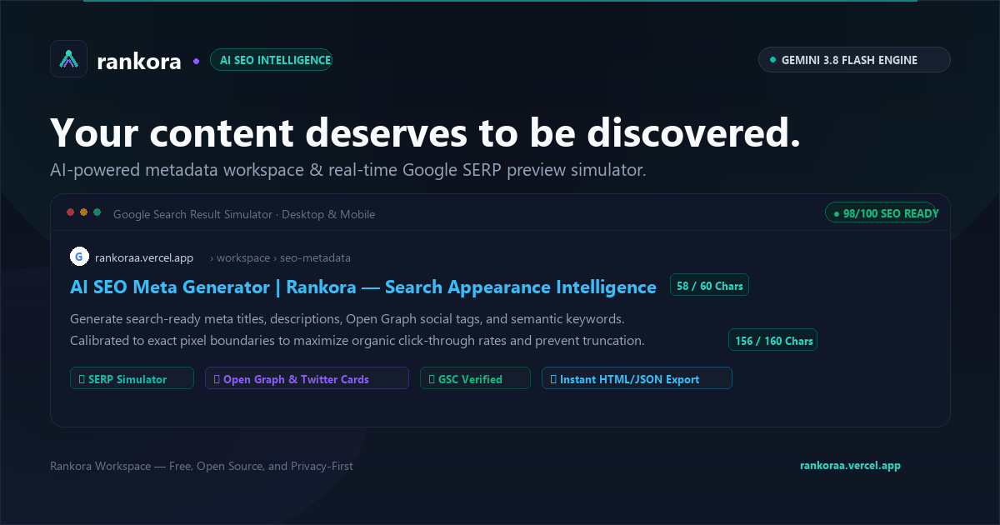

<p align="center">
  
</p>

# Rankora — AI SEO Intelligence Workspace

> **Deterministic. High-CTR Search Metadata. In Seconds.**

Rankora is a production-grade, AI-orchestrated SEO metadata intelligence studio and live Google SERP simulator. Powered by Google Gemini 3.8 Flash, Rankora helps developers, creators, marketers, and engineering teams generate pixel-calibrated meta titles, descriptions, Open Graph protocol social cards, and Schema.org structured data with 100% Google Search Central compliance.

[](https://rankoraa.vercel.app/)
[](https://www.python.org/)
[](https://flask.palletsprojects.com/)
[](https://aistudio.google.com/)
[](LICENSE)
[](https://rankoraa.vercel.app/)
[](https://render.com/)

🚀 **Live Production Application:** [https://rankoraa.vercel.app/](https://rankoraa.vercel.app/)  
*(Legacy domain `ai-seo-meta-generator.vercel.app` automatically performs a permanent 301 redirect to `rankoraa.vercel.app`).*

---

## ⚡ Key Highlights & Capabilities

### 1. OneText-Inspired Landing Page Architecture
- **Floating Pill Top Navbar**: A glassmorphic rounded header (`rgba(16, 24, 38, 0.78)`) featuring a white speech-bubble brand tag (`rankora.`), smooth pill navigation links, and a high-contrast rounded outline CTA button (`Get started →`).
- **Asymmetric Two-Column Split Hero**: Bold, clean editorial typography featuring the monumental headline `"20% More Organic CTR. Guaranteed."`, concise value proposition subtext, and real-time micro-metrics.
- **Hero Quick-Interactive URL / Topic Bar**: An integrated search bar directly in the hero (`[ AI* ] [ Enter your brand's URL or page topic... ] [ Test our AI → ]`). Entering a topic or URL smoothly transfers input to the studio, auto-scrolls, and launches inference.
- **Photorealistic 3D Kinetic Sculpture Background**: A high-resolution Octane 3D render of a mechanical kinetic installation with glossy cobalt blue, cherry red, and warm amber tracks, chrome gears, coiled spring, and glowing spheres with dark slate gradient masking.
- **Floating Customer Proof & Platform Shelf**: A bottom dock featuring a verified testimonial from Alex Rivera (*Founder of Native SEO & TechRank*), 5-star rating, and technology compatibility badges for `Next.js`, `Vercel`, `Shopify`, `Astro`, and `WordPress`.

### 2. 12-Column Real-Time SEO Studio Workspace
- **Google Pixel-Calibrated Meta Bounds**: Enforces strict boundaries (50–60 characters for titles, 150–160 characters for descriptions) so your search snippets never truncate on mobile or desktop search results.
- **Live Google SERP Simulator**: Pixel-accurate desktop and mobile Google Search snippet previews, complete with URL breadcrumbs, title styling, and favicon rendering.
- **Multi-Tab Preview Engine**: Switch instantly between **Google SERP View**, **Open Graph Social Card View** (LinkedIn, X/Twitter, Facebook, Slack), **JSON-LD Schema Markup**, and **HTML `<head>` Code Export**.
- **SEO Readiness Meter**: Dynamic 0–100 quality audit gauge evaluating title boundaries, description completeness, keyword inclusion, and social card integrity.
- **Dual Inference Engine**: Powered by Google Gemini 3.8 Flash via the official `google-genai` SDK with an automatic fallback heuristic engine when offline or out of quota.

### 3. Japanese Origami-Inspired Interactive FAQ Experience
- **Editorial Paper-Folding Aesthetics**: Transforms standard accordions into interactive folded paper panels with geometric fold creases, origami dog-ears, and smooth unfolding animations.
- **Dual Schema.org Structured Data**: Fully indexed with Google-compliant `FAQPage` JSON-LD and microdata for organic rich snippets.

### 4. Community Voice, Testimonials & Public Roadmap
- **What Builders Say**: Dynamic horizontal review cards with infinite marquee animation displaying verified community feedback.
- **Community Voice & Roadmap**: Direct in-app feedback console with interactive 5-star rating, character counter, prompt chips, and instant submission.
- **Public Issue & Feature Tracker**: Transparent, live public roadmap displaying real-time issue status (`Open`, `In Progress`, `Resolved`).

### 5. Rankora Private Admin Console (`/admin`)
- **Moderation Dashboard**: Dedicated admin console to review and moderate submitted testimonials (approve to display on the live homepage) and update roadmap issue statuses.
- **High-Contrast Theme**: Styled in Dark Carbon (`#0C1015`) and Vivid Violet (`#8952e0`) with an ultra-visible **Connect Console** button.
- **Secure Session Authentication**: Protected via `ADMIN_SECRET` in `.env`. Supports `X-ADMIN-SECRET` header, password visibility eye toggle, and persistent session storage.

### 6. Unified Single Static Architecture
- Consolidated all static assets into a single directory: `public/static/`. Both local Flask development and Vercel edge deployment serve directly from this source of truth without duplicate file maintenance.

---

## 🎨 Design System & Color Palette

Rankora follows a high-contrast dark theme calibrated for developer tools and analytical dashboards:

| Token | Hex / Value | Description |
| :--- | :--- | :--- |
| **Canvas / Background** | `#0C1015` | Dark Carbon / Slate base canvas |
| **Secondary Surface** | `#19202b` | Deep Navy card and surface background |
| **Primary Accent** | `#8952e0` / `#9461e3` | Vivid Purple / Violet CTA gradients and glowing highlights |
| **Action Highlight** | `#2ab4d9` | Electric Cyan for focus states and technical accents |
| **Success / Verified** | `#00FF90` | Cyber Lime for 100% scores and verified badges |
| **Warning / Rating** | `#F59E0B` | Warm Amber for star ratings and pending statuses |
| **Typography** | `Space Grotesk`, `Inter`, `JetBrains Mono` | Editorial display headers, body prose, and monospace code |

---

## 🛠 Tech Stack

- **Backend**: Python 3.11+, Flask 3.0+, Gunicorn
- **AI / LLM**: Google Gemini API (`gemini-3.8-flash`) via the modern official `google-genai` SDK
- **Frontend**: Semantic HTML5, Vanilla JavaScript (ES6+), Modern CSS3 (CSS Variables, Grid, Flexbox)
- **Animations**: Anime.js, CSS Keyframes, WebGL Three.js foundation
- **Persistence**: Thread-safe atomic JSON file storage (`data/feedbacks.json`)
- **Deployment**: Vercel Serverless Edge (`vercel.json`) & Render Cloud Web Service (`render.yaml`, `Procfile`)

---

## 📁 Project Directory Structure

```text
ai-seo-meta-generator/
├── api/
│   └── index.py                 # Vercel Serverless edge entrypoint
├── data/
│   └── feedbacks.json           # Thread-safe persistent storage for feedback & issues
├── public/
│   ├── static/                  # Single source of truth for all static assets
│   │   ├── assets/brand/        # Official SVG logos and icons
│   │   ├── hero-kinetic.jpg     # Photorealistic 3D kinetic sculpture artwork
│   │   ├── og-image.png         # 1200x630 canonical social share card
│   │   ├── script.js            # Frontend application logic and animations
│   │   ├── style.css            # Comprehensive design system stylesheet
│   │   ├── site.webmanifest     # Progressive Web App manifest
│   │   └── favicon.*            # Multi-format favicons (ICO, SVG, PNG)
│   ├── robots.txt               # Search engine crawling directives
│   └── google*.html             # Google Search Console ownership verification
├── templates/
│   ├── index.html               # Main application workspace & landing page
│   └── admin.html               # Private admin moderation console
├── .env.example                 # Environment variables template
├── app.py                       # Main Flask application and API route controllers
├── Procfile                     # Process file for Render / Heroku
├── render.yaml                  # Render Cloud infrastructure definition
├── requirements.txt             # Python dependencies
└── vercel.json                  # Vercel routing and edge configuration
```

---

## 🚀 Quickstart & Local Setup

### Prerequisites
- Python 3.11 or higher
- Git
- A Google Gemini API Key (get one free at [aistudio.google.com](https://aistudio.google.com/))

### 1. Clone the repository
```bash
git clone https://github.com/ivengexnce/ai-seo-meta-generator.git
cd ai-seo-meta-generator
```

### 2. Set up virtual environment
```bash
# macOS / Linux
python3 -m venv .venv
source .venv/bin/activate

# Windows (PowerShell)
python -m venv .venv
.venv\Scripts\Activate.ps1
```

### 3. Install dependencies
```bash
pip install -r requirements.txt
```

### 4. Configure environment variables
Create your local `.env` file from the provided template:
```bash
cp .env.example .env
```

Edit `.env` with your preferred credentials:
```ini
# Gemini API Key (optional for testing; app includes offline fallback)
GEMINI_API_KEY=your_gemini_api_key_here

# Local Development Port
PORT=5000

# Private Admin Console Authentication Secret
ADMIN_SECRET=meetmaru@1953

# Canonical Base URL
CANONICAL_URL=https://rankoraa.vercel.app

# Google Site Verification Token (optional)
GOOGLE_SITE_VERIFICATION=your_verification_token_here
```

### 5. Run the application
```bash
python app.py
```
Open **[http://localhost:5000](http://localhost:5000)** in your browser.  
Open **[http://localhost:5000/admin](http://localhost:5000/admin)** to access the private moderation console.

---

## 📡 REST API Documentation

### 1. Metadata Generation
`POST /api/generate` (or `/generate`)

Analyzes raw text or URL content and returns Google Search and Open Graph calibrated tags.

**Request Body:**
```json
{
  "content": "Rankora is an AI-powered SEO metadata intelligence workspace that generates click-worthy meta tags and live SERP previews.",
  "focus_keywords": "AI SEO, SERP simulator, meta tags",
  "api_key": "optional_client_side_override"
}
```

**Response (200 OK):**
```json
{
  "meta_title": "AI SEO Meta Generator | Rankora — Search Intelligence",
  "meta_description": "Generate search-calibrated meta titles, descriptions, and Open Graph tags. Live Google SERP simulator ensures zero truncation.",
  "og_title": "Rankora — Your Content Deserves to Be Discovered",
  "og_description": "Deterministic, AI-orchestrated SEO metadata and real-time Google search snippet previews.",
  "og_type": "website",
  "keywords": ["AI SEO", "Meta Tag Generator", "SERP Simulator", "Open Graph", "Technical SEO"]
}
```

---

### 2. Public Community Endpoints

#### Approved Testimonials
`GET /api/testimonials`
- **Access**: Public
- **Description**: Returns all admin-approved testimonials sorted newest first for the homepage review marquee.

#### Public Roadmap & Issues
`GET /api/issues`
- **Access**: Public
- **Description**: Returns logged community feature requests and bug reports.

#### Submit Feedback / Issue
`POST /api/feedback`
- **Access**: Public
- **Body**:
```json
{
  "name": "Sarah Connor",
  "message": "The SERP simulator accurately caught our title truncation before deploy!",
  "type": "testimonial",
  "rating": 5
}
```

---

### 3. Administrative Moderation Endpoints

All admin endpoints require authentication via the `X-ADMIN-SECRET` header matching `ADMIN_SECRET` in `.env`.

| Method | Endpoint | Description |
| :--- | :--- | :--- |
| `GET` | `/api/feedback` | Fetch all feedbacks, testimonials, and issues |
| `PATCH` | `/api/feedback/<id>/approve` | Toggle approval (`{"approved": true}`) |
| `PATCH` | `/api/feedback/<id>/status` | Update issue status (`{"status": "in_progress"}`) |
| `DELETE` | `/api/feedback/<id>` | Delete an item permanently |

---

### 4. Search Engine Crawling Endpoints

- `GET /sitemap.xml`: Delivers dynamic search engine sitemap with canonical URLs and daily modification timestamps.
- `GET /robots.txt`: Directs search crawlers to the sitemap and indexing permissions.
- `GET /health` (or `/api/health`): Returns JSON health status for uptime monitors.

---

## 🔒 Privacy & Zero Retention Architecture

Rankora is built on strict data minimization principles:
- **Zero Storage of Inputs**: Submitted text is passed directly to the Gemini model for on-demand inference and discarded immediately. No page text is logged, sold, or used for model training.
- **Client-Side Key Storage**: When you provide your own Google AI Studio key, it stays strictly in your browser's local `localStorage`. It is never stored on backend databases or shared.

---

## 🚢 Deployment Guide

### Deploying to Vercel (Recommended)
1. Fork or push this repository to GitHub.
2. Import the project into your Vercel Dashboard.
3. In Project Settings, configure Environment Variables:
   - `GEMINI_API_KEY`: Your Google AI Studio API key.
   - `ADMIN_SECRET`: Your chosen administrative secret.
   - `CANONICAL_URL`: `https://your-custom-domain.com`.
4. Click **Deploy**. Vercel will automatically build the serverless functions via `api/index.py` and serve static assets directly from `public/`.

### Deploying to Render
1. Create a new **Web Service** on Render and connect your GitHub repo.
2. Set Environment to **Python 3**.
3. Build Command: `pip install -r requirements.txt`.
4. Start Command: `gunicorn app:app`.
5. Add your environment variables in the Render Dashboard.

---

## 🤝 Contributing

Contributions are welcomed!
1. Fork the Project.
2. Create your Feature Branch (`git checkout -b feature/AmazingFeature`).
3. Commit your Changes (`git commit -m 'feat: add AmazingFeature'`).
4. Push to the Branch (`git push origin feature/AmazingFeature`).
5. Open a Pull Request.

Please check [CONTRIBUTING.md](CONTRIBUTING.md) for detailed guidelines.

---

## 📄 License

Distributed under the **MIT License**. See [`LICENSE`](LICENSE) for more details.

---

<p align="center">
  <b>Rankora</b> — Built with precision for developers, marketers, and creators worldwide.
</p>
